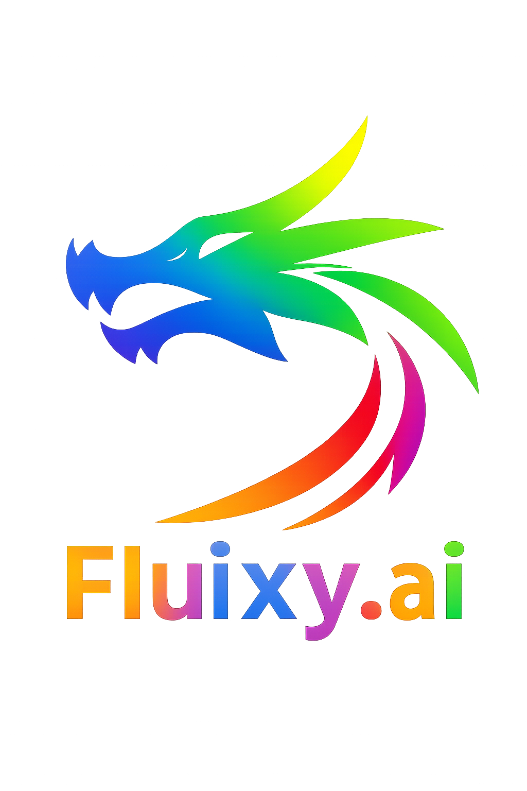

<p align="center">
  
</p>

<h1 align="center">Fluixy.Ai</h1>

<p align="center">
  <strong>Where Ideas Begin ΓÜí</strong>
</p>

<p align="center">
  An AI-powered full-stack web development assistant that brings your ideas to life in seconds
</p>

<p align="center">
  <a href="#features">Features</a> ΓÇó
  <a href="#getting-started">Getting Started</a> ΓÇó
  <a href="#tech-stack">Tech Stack</a> ΓÇó
  <a href="#usage">Usage</a> ΓÇó
  <a href="#contributing">Contributing</a>
</p>

---

## 🚀 About Fluixy.Ai

**Fluixy.Ai** is an intelligent AI coding assistant that helps you build full-stack web applications with ease. Simply describe what you want to build, and Fluixy.Ai will generate the code, create files, and set up your project automatically.

Built with a beautiful cyan-themed interface featuring a rainbow dragon logo, Fluixy.Ai provides a seamless development experience with real-time code generation, file management, and an integrated preview environment.

## ✨ Features

- 🤖 **AI-Powered Code Generation** - Describe your idea and watch it come to life
- 📁 **Full-Stack File Management** - Automatic file creation, editing, and organization
- 🖥️ **Live Preview** - See your changes in real-time with the built-in preview
- 🎨 **Beautiful UI** - Modern, responsive interface with light/dark theme support
- 🔧 **Multi-Model Support** - Works with various AI providers (Google Gemini, OpenAI, Anthropic, and more)
- 💾 **Chat History** - Save and resume your development conversations
- 📤 **Export & Import** - Easily backup and share your projects
- 🔗 **GitHub Integration** - Clone repos and deploy directly to GitHub
- 🌐 **Starter Templates** - Quick start with popular frameworks (React, Vue, Next.js, etc.)

## 🛠️ Tech Stack

| Category | Technologies |
|----------|-------------|
| **Frontend** | React, Remix, TypeScript, UnoCSS |
| **AI Integration** | AI SDK, Multiple LLM Providers |
| **State Management** | Nanostores |
| **Styling** | SCSS, CSS Variables, UnoCSS |
| **Build Tool** | Vite |
| **Package Manager** | pnpm |

## 🚦 Getting Started

### Prerequisites

- Node.js 18+ 
- pnpm (recommended)

### Installation

1. **Clone the repository**
   ```bash
   git clone https://github.com/adityajai119/Fluixy.ai.git
   cd Fluixy.ai
   ```

2. **Install dependencies**
   ```bash
   pnpm install
   ```

3. **Set up environment variables**
   ```bash
   cp .env.example .env.local
   ```
   Add your API keys (e.g., Google Gemini, OpenAI) to the `.env.local` file.

4. **Start the development server**
   ```bash
   pnpm run dev
   ```

5. **Open your browser**
   Navigate to `http://localhost:5173` and start building!

## 💡 Usage

1. **Enter your API Key** - Configure your preferred AI provider in the settings
2. **Start a new chat** - Click "Start new chat" or describe your project idea
3. **Describe your idea** - Tell Fluixy.Ai what you want to build
4. **Watch it build** - See the AI generate code, create files, and build your app
5. **Preview & Iterate** - Use the live preview and make adjustments as needed
6. **Export** - Download your completed project or push to GitHub

## 🎨 Themes

Fluixy.Ai supports both light and dark themes with a beautiful cyan color palette:

- **Dark Mode**: Perfect for late-night coding sessions
- **Light Mode**: Clean and professional for daytime use

Toggle themes using the theme switch button in the header.

## 📸 Screenshots

Coming soon...

## 🤝 Contributing

Contributions are welcome! Feel free to:

1. Fork the repository
2. Create a feature branch (`git checkout -b feature/amazing-feature`)
3. Commit your changes (`git commit -m 'Add amazing feature'`)
4. Push to the branch (`git push origin feature/amazing-feature`)
5. Open a Pull Request

## 📄 License

This project is licensed under the MIT License.

## 👨‍💻 Author

**Aditya**

- GitHub: [@adityajai119](https://github.com/adityajai119)

---

<p align="center">
  Made with ❤️ by Aditya
</p>

<p align="center">
  <strong>Where ideas begin ΓÜí</strong>
</p>

---

## Attribution

Fluixy.Ai is built on top of [bolt.diy](https://github.com/stackblitz-labs/bolt.diy), created by StackBlitz, Inc. and the bolt.diy contributors, and is distributed under the [MIT License](LICENSE).
